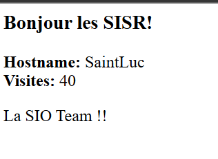

<h1 align="center">TP Docker - BTS SIO SISR</h1>

  Compte rendu de TP réalisé sur une VM Debian 12 (Proxmox) : images, containers, Dockerfile et Docker Compose.

  
  
  
  

  

## Sommaire

| Partie | Contenu | Compte rendu |
|---|---|---|
| 1 | Installation de Docker et docker-compose sur Debian 12 | [Ouvrir](TP-Docker/README.md#installation-de-docker-) |
| 2 | Images et containers : nginx, Apache, commandes de base | [Ouvrir](TP-Docker/README.md#images-et-containers-) |
| 3 | Création de nos propres images avec un Dockerfile (Debian et Alpine) | [Ouvrir](TP-Docker/README.md#création-de-notre-image-) |
| 4 | Orchestration avec Docker Compose : appli Flask + base Redis | [Ouvrir](TP-Docker/README.md#orchestrer-des-containers-) |

## Fichiers

| Dossier | Contenu |
|---|---|
| [`TP-Docker/lab0`](TP-Docker/lab0) | Dockerfile de l'image Debian |
| [`TP-Docker/lab1`](TP-Docker/lab1) | Dockerfile de l'image Alpine |
| [`TP-Docker/projet`](TP-Docker/projet) | `app.py`, `requirements.txt`, `Dockerfile` et `docker-compose.yml` |

## Technologies utilisées

| Rôle | Outil |
|---|---|
| Virtualisation | Proxmox VE |
| Système hôte | Debian 12 |
| Containers | Docker 20.10 |
| Orchestration | Docker Compose 1.29 |
| Serveurs web testés | nginx, Apache (httpd) |
| Application | Python Flask + Redis |
