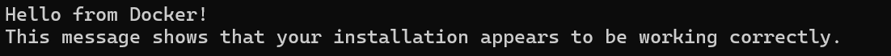
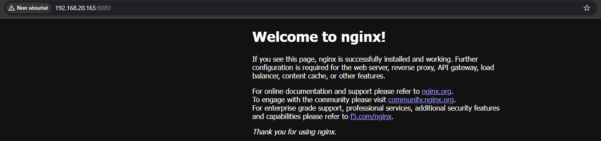
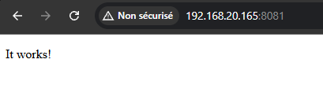
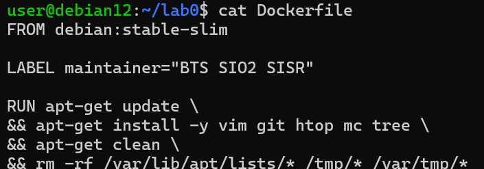
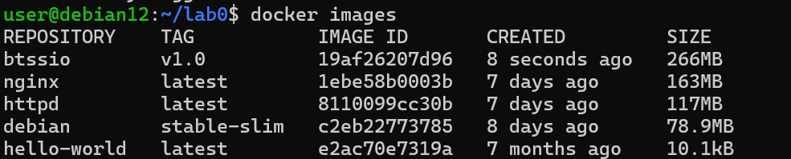
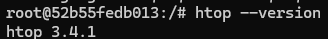
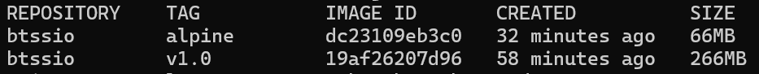
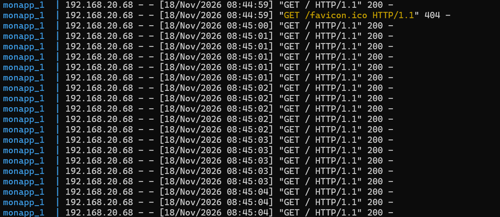
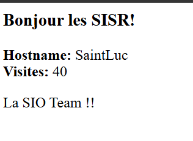
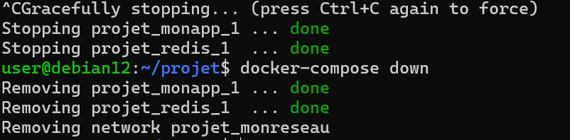

# TP - Docker

## 👨‍💻 Informations Générales

**Auteur :** Hugo V.

**Formation :** BTS SIO 2

**Module :** B2 SISR

**Matériel :** VM Debian 12, Docker, Docker-Compose

## 📁 Fichiers du TP

| Dossier | Contenu |
| --- | --- |
| [`lab0`](lab0) | Dockerfile de l'image Debian |
| [`lab1`](lab1) | Dockerfile de l'image Alpine |
| [`projet`](projet) | `app.py`, `requirements.txt`, `Dockerfile` et `docker-compose.yml` |

# Installation de Docker :

Sur notre VM Debian 12, nous allons récupérer le paquet Debian de Docker et Docker Compose

Cette version n’est pas la plus récente mais suffira pour notre utilisation et elle évite d’utiliser un script d’installation.

```bash
sudo apt update
sudo apt install -y docker.io docker-compose
sudo usermod -aG docker $USER
```

Une fois cette étape faite, nous vérifions la version de docker et de docker-compose puis nous lançons un :

```bash
docker run hello-world
```

Nous obtenons **Docker 20.10.24** et **docker-compose 1.29.2**. Le paquet Debian installe la commande `docker-compose` avec un tiret, comme dans le sujet.

Docker nous répond « Hello from Docker! », cela signifie que l’installation est correctement terminée.



# Images et containers :

Nous installons maintenant **nginx** :

```bash
docker run -p 8080:80 -d nginx
```

- `run` : lance le service
- `-p 8080:80` : mappe le port 8080 de la machine host vers le port 80 du container
- `-d` : mode détaché
- `nginx` : image



| Commande | Fonction |
| --- | --- |
| `docker ps` | Affiche la liste des containers **en cours d’exécution** (ID, image, commande, statut, ports, nom). |
| `docker ps -a` | Affiche la liste de **tous** les containers, y compris ceux qui sont **arrêtés** (`-a` = all). |
| `docker images` | Affiche la liste des **images** présentes en local sur la machine (nom, tag, ID, date de création, taille). |

| Question | Réponse |
| --- | --- |
| Comment arrêter un container ? | `docker stop <nom ou ID>` |
| Comment supprimer un container ? | `docker rm <nom ou ID>` (le container doit être arrêté, sinon `docker rm -f`) |
| Comment supprimer une image ? | `docker rmi <nom de l'image>` (aucun container ne doit l’utiliser) |
| Télécharger l’image Apache | `docker pull httpd` |
| Lancer Apache en détaché avec le port 8081 mappé sur le port 80 | `docker run -d -p 8081:80 httpd` |

Une fois Apache installé, nous testons la connexion et tout fonctionne :



# Création de notre image :

Avant de commencer, on éteint et supprime les anciens containers :

```bash
docker stop <nom_du_container>
docker rm <nom_du_container>
```

Afin de créer notre propre image nous allons d’abord créer un dossier et le fichier :

```bash
mkdir lab0 && cd lab0
nano Dockerfile
```

Puis à l’intérieur de ce fichier, nous insérons le contenu :



```dockerfile
FROM debian:stable-slim

LABEL maintainer="BTS SIO2 SISR"

RUN apt-get update \
&& apt-get install -y vim git htop mc tree \
&& apt-get clean \
&& rm -rf /var/lib/apt/lists/* /tmp/* /var/tmp/*
```

Toutes les commandes sont dans un seul `RUN` pour ne créer qu’une seule couche, et la dernière ligne supprime les fichiers temporaires pour alléger l’image. Nous avons ajouté `tree`, annoncé dans le sujet mais absent de la commande, et remplacé `MAINTAINER`, qui est déprécié, par `LABEL`.

Ensuite, nous pouvons construire l’image à l’aide de la commande :

```bash
docker build -t btssio:v1.0 .
```

Les étapes défilent puis après une minute ou deux, le build est fonctionnel.

On vérifie sa taille avec la commande :

```bash
docker images
```

Ici nous pouvons voir que l’image btssio fait **266MB**.



Pour lancer le container :

```bash
docker run -tid --name sisr btssio:v1.0
```

Pour y entrer et vérifier le fonctionnement de nos applications :

```bash
docker exec -ti sisr bash
```

Comme nous pouvons le constater sur cet exemple, nous retrouvons bien notre paquet **htop** ainsi que sa version, il est donc bien installé comme prévu dans le container.



Le sujet demande une image beaucoup plus légère avec l’indice « France en Formule 1 », ce qui correspond à l’écurie **Alpine**. Afin d’avoir les mêmes fonctionnalités, nous utilisons donc **Alpine Linux**, une distribution conçue pour être minuscule : à titre de comparaison, elle fait environ 5 Mo contre environ 79 Mo pour Debian.

Nous créons un second dossier avec un nouveau Dockerfile :

```bash
mkdir lab1 && cd lab1
nano Dockerfile
```

```dockerfile
FROM alpine:latest
LABEL maintainer="BTS SIO2 SISR"
RUN apk add --no-cache vim git htop mc tree
```

Alpine utilise `apk` à la place de `apt-get`. L’option `--no-cache` évite de garder l’index des paquets, il n’y a donc pas besoin de nettoyage. Nous construisons l’image puis nous vérifions sa taille :

```bash
docker build -t btssio:alpine .
docker images
```

Pour tester les outils, nous entrons dans le container avec `sh` car Alpine n’a pas `bash` :

```bash
docker run -tid --name sisr2 btssio:alpine
docker exec -ti sisr2 sh
```

| Image | Base | Taille |
| --- | --- | --- |
| btssio:v1.0 | Debian stable-slim | 266 Mo |
| btssio:alpine | Alpine | 66 Mo |

Cela montre donc qu’une fois le build réalisé, la taille de notre version **Alpine** est 4x plus petite que la version **Debian** pourtant les deux possèdent les mêmes fonctionnalités.



# Orchestrer des containers :

> [!TIP]
> **Docker Compose** permet de lancer plusieurs containers en même temps à partir d'un seul fichier. Ici l'appli des développeurs a besoin de deux choses :
>
> - **Flask** : le site web en Python
> - **Redis** : la base de données qui garde le compteur de visites

Sans Redis, la page s'affiche mais sans le compteur, on a donc besoin de deux containers.

On commence par créer un dossier pour le projet :

```bash
mkdir projet && cd projet
```

Dans ce dossier, on crée d'abord le fichier **requirements.txt** qui contient les paquets Python que `pip` va installer dans l'image (Flask et Redis) :

```bash
nano requirements.txt
```

```text
Flask
Redis
```

Puis le fichier **app.py** fourni par les développeurs :

```bash
nano app.py
```

```python
from flask import Flask
from redis import Redis, RedisError
import os
import socket

# Connect to Redis
redis = Redis(host="redis", db=0, socket_connect_timeout=2, socket_timeout=2)

app = Flask(__name__)

@app.route("/")
def hello():
    try:
        visites = redis.incr("compteur")
    except RedisError:
        visites = "<i>Erreur de connection Redis, compteur desactive</i>"

    html = "<h3>Bonjour {nom}!</h3>" \
           "<b>Hostname:</b> {hostname}<br/>" \
           "<b>Visites:</b> {visites} <br/>" \
           "<p>La SIO Team !!</p>"
    return html.format(nom=os.getenv("NOM", "El Greco"), hostname=socket.gethostname(), visites=visites)

if __name__ == "__main__":
    app.run(host='0.0.0.0', port=80)
```

Dans ce code, l'appli se connecte à Redis avec `host="redis"`, donc le service Redis devra forcément s'appeler `redis` dans le docker-compose. À chaque visite le compteur augmente de 1, et la page affiche aussi le hostname du container et la variable `NOM`. Si Redis n'est pas lancé, la page s'affiche quand même mais avec un message d'erreur à la place du compteur.

Ensuite on crée le **Dockerfile** de l'appli :

```bash
nano Dockerfile
```

```dockerfile
FROM python:2.7-slim
WORKDIR /app
COPY . /app
RUN pip install -r requirements.txt
EXPOSE 80
ENV NOM BTS SIO2 SISR
CMD ["python", "app.py"]
```

On part d'une image avec Python déjà installé, on copie nos fichiers dans `/app` puis on installe Flask et Redis avec `pip`. L'appli écoute sur le port 80, la variable `NOM` vaut « BTS SIO2 SISR » par défaut, et au démarrage du container c'est `app.py` qui se lance.

Puis on construit l'image (sans oublier le point à la fin) :

```bash
docker build -t monimage .
```

Il faut bien faire cette étape avant, car le docker-compose va chercher l'image `monimage` en local. Pendant le build, pip affiche un message en rouge parce que Python 2.7 n'est plus maintenu, mais le build se termine quand même.

Pour finir, on crée le fichier **docker-compose.yml**. Attention à bien mettre des espaces (pas de tabulations) et à respecter la casse :

```bash
nano docker-compose.yml
```

```yaml
version: "3"
services:
  monapp:
    image: monimage
    hostname: SaintLuc
    depends_on:
      - redis
    ports:
      - "80:80"
    networks:
      - monreseau
    environment:
      - NOM=les SISR
  redis:
    image: redis
    networks:
      - monreseau

networks:
  monreseau:
```

Dans ce fichier on a deux services : `monapp` qui utilise notre image, et `redis` qui utilise l'image officielle du Docker Hub. Les deux sont sur le même réseau `monreseau` pour pouvoir communiquer, et `depends_on` fait démarrer Redis en premier. Seul `monapp` a un port ouvert (80), Redis reste accessible uniquement en interne.

On a aussi ajouté `hostname: SaintLuc`, c'est la modif demandée à la fin du sujet. La ligne `NOM=les SISR` remplace la valeur du Dockerfile, donc la page affichera « les SISR ».

On lance tout avec :

```bash
docker-compose up
```

Le réseau est créé, Redis démarre puis l'appli, et les logs des deux containers s'affichent dans le terminal :



On voit les logs de `redis_1` et de `monapp_1`. Redis affiche `Ready to accept connections` et Flask `Running on http://0.0.0.0:80/`, donc les deux sont bien lancés.

Il y a deux warnings (Redis sans mot de passe et serveur Flask de développement) mais ça ne pose pas de problème pour un TP.

À chaque fois qu'on actualise la page, une ligne `GET / HTTP/1.1 200` s'ajoute dans les logs (200 = la requête a marché). Le `404` sur `favicon.ico` c'est juste le navigateur qui cherche l'icône du site, qui n'existe pas.

On ouvre ensuite la page dans le navigateur avec l'IP de la VM et on actualise plusieurs fois :



La page affiche bien « Bonjour les SISR! » (c'est la variable du docker-compose qui est prise et pas celle du Dockerfile), le hostname **SaintLuc** et le compteur de visites qui monte à chaque actualisation (ici 40). Le compteur marche, donc l'appli arrive bien à joindre Redis.

Une fois le test fini, on arrête les containers avec `Ctrl+C` puis on les supprime avec le réseau :

```bash
docker-compose down
```

`Ctrl+C` arrête seulement les containers, alors que `docker-compose down` les supprime en plus du réseau :



Comme demandé dans le sujet, on efface les containers et les images à la fin du TP :

```bash
docker rm -f $(docker ps -aq)
docker rmi $(docker images -q)
```

Le `-q` affiche seulement les ID, ce qui permet de tout supprimer d'un coup. Attention, ça supprime tous les containers et toutes les images de la VM.

# Conclusion :

Ce TP nous a permis d’installer Docker sur une VM Debian 12, de lancer des containers à partir d’images du Docker Hub (nginx et Apache) et de créer nos propres images avec un Dockerfile. Alpine fait 66 Mo contre 266 Mo pour Debian, avec les mêmes outils.

Avec Docker Compose, on a pu lancer une appli qui utilise deux containers (Flask et Redis) avec une seule commande, et changer le nom ou le hostname directement dans le fichier sans refaire l'image.
